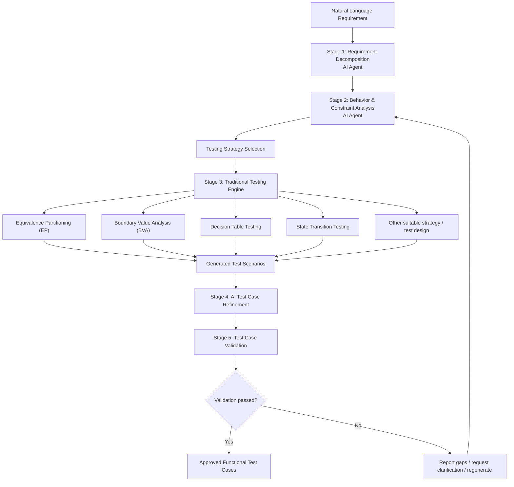
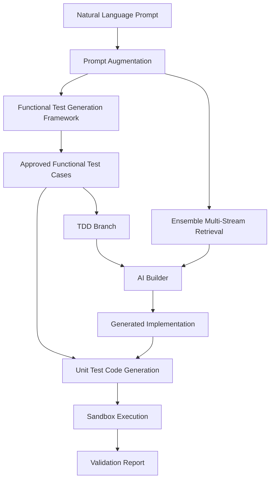

# Hybrid AI-Based Functional Test Case Generation Framework

## 1. Overview

This module generates **Functional Test Cases** from Natural Language Requirements by combining:

- **AI-based requirement understanding**: decomposes requirements, identifies behaviors and constraints, and selects suitable testing techniques.
- **Traditional testing techniques**: generates test scenarios using systematic, reusable rules and algorithms.
- **AI-based test case refinement**: converts generated scenarios into structured Functional Test Cases.
- **Validation**: checks coverage, consistency, traceability, and whether expected behaviors are supported by the specification.

The key principle is:

> AI interprets the requirement and selects an appropriate testing strategy. The Testing Engine applies the selected technique to generate scenarios. AI may format and enrich the scenarios, but must not invent constraints or expected behaviors that are not supported by an approved requirement or specification.

This module produces **Functional Test Case specifications**, not executable unit-test code. A later stage can convert the approved specifications into unit tests after the implementation and its interfaces are available.

---

## 2. High-Level Workflow



### Stage 1 — Requirement Decomposition (AI Agent)

**Purpose:** Convert an unstructured Natural Language Requirement into structured information.

Extract, where applicable:

- Functionality or feature being described.
- Actors and actions.
- Inputs and data types.
- Constraints and conditions.
- Preconditions and postconditions.
- Expected behaviors.
- Side effects, such as file creation, database changes, or external interactions.
- Exceptions and error conditions.
- Requirement references or source sentences.

Example output:

```json
{
  "requirement_id": "REQ-001",
  "functionality": "User Registration",
  "inputs": [
    {
      "name": "username",
      "type": "string",
      "constraints": {
        "min_length": 3,
        "max_length": 20
      }
    },
    {
      "name": "password",
      "type": "string",
      "constraints": {
        "min_length": 8
      }
    }
  ],
  "conditions": [
    "Username must not already exist"
  ],
  "expected_behaviors": [
    "Create an account if all conditions are satisfied",
    "Reject registration otherwise"
  ],
  "side_effects": [
    "Create a new account"
  ]
}
```

The output is an intermediate representation (IR) for subsequent stages. It should preserve the source requirement so that extracted information can be traced back to it.

### Stage 2 — Behavior & Constraint Analysis (AI Agent)

**Purpose:** Identify testable behaviors, determine which constraints are sufficiently specified, and select appropriate testing techniques.

Typical behavior categories and candidate techniques:

| Behavior / constraint | Candidate testing technique |
|---|---|
| Input belongs to valid and invalid groups | Equivalence Partitioning (EP) |
| Numeric, length, date, or collection boundaries | Boundary Value Analysis (BVA) |
| Multiple Boolean conditions affect an outcome | Decision Table Testing |
| Behavior depends on the current state and an event | State Transition Testing |
| State or data is changed | State verification |
| File, database, or external-service interaction | Side-effect / interaction testing |
| Error or exceptional conditions | Negative testing |

The AI Agent should select techniques based on the extracted behavior, not apply every technique to every requirement.

#### Constraint provenance

Every extracted constraint should record where it came from:

| Source | Meaning | Can it define an expected result? |
|---|---|---|
| `explicit_requirement` | Explicitly stated in the original requirement | Yes |
| `approved_specification` | Present in an approved system specification | Yes |
| `inferred` | Suggested by AI but not explicitly supported | No, requires confirmation |
| `unknown` | Cannot be determined | No, clarification is required |

For example, if a requirement says only "the username must be valid" and gives no length or format rules, the system must not invent a minimum or maximum length. It should mark the missing constraint as `NEEDS_CLARIFICATION` or continue only with behaviors that can be tested from known information.

### Stage 3 — Traditional Testing Engine

**Purpose:** Generate test scenarios using reusable algorithms and rules rather than hardcoding test cases for individual functions.

The engine contains independent strategy modules, for example:

- **EP Engine:** derives valid and invalid equivalence classes from confirmed constraints.
- **BVA Engine:** generates values around confirmed boundaries.
- **Decision Table Engine:** derives combinations of conditions and their specified outcomes.
- **State Transition Engine:** derives transitions and scenarios from a defined state model.
- **Side-effect / interaction strategy:** defines observable effects to verify, such as a created file, changed database state, or invoked external dependency.

The AI Agent selects the relevant strategy and passes the structured requirement data to the corresponding engine. The engine then applies its predefined algorithm.

#### Example: BVA

For a confirmed username length range of 3 to 20 characters, a BVA engine can generate:

| Length | Classification |
|---:|---|
| 2 | Invalid — just below minimum |
| 3 | Valid — minimum |
| 4 | Valid — just above minimum |
| 19 | Valid — just below maximum |
| 20 | Valid — maximum |
| 21 | Invalid — just above maximum |

For a one-sided constraint such as `password.length >= 8`, the engine can generate lengths 7, 8, and 9. It must not invent an upper boundary.

The engine should support different data types and constraint forms over time. Not every requirement has numeric or length boundaries, so BVA is optional and should only run when applicable.

### Stage 4 — AI Test Case Refinement

**Purpose:** Convert the scenarios produced by the Testing Engine into consistent, readable Functional Test Cases.

The AI Agent can:

- Add a clear scenario description.
- Organize inputs and preconditions.
- Express expected observable behavior.
- Attach requirement and behavior references.
- Identify the testing technique used.
- Normalize the output schema and remove obvious duplicates.

The AI must preserve the scenarios and expected outcomes established by the requirement and testing rules. It must not add unsupported business rules or expected behaviors.

Suggested Functional Test Case schema:

```json
{
  "test_case_id": "TC-001",
  "requirement_id": "REQ-001",
  "behavior_id": "B-001",
  "scenario": "Username length is below the minimum",
  "preconditions": [
    "Registration service is available"
  ],
  "action": {
    "function": "register",
    "arguments": {
      "username": "ab",
      "password": "password123"
    }
  },
  "expected_behaviors": [
    {
      "type": "result",
      "expected": "Reject registration"
    },
    {
      "type": "state",
      "expected": "No account is created"
    }
  ],
  "testing_technique": [
    "EP",
    "BVA"
  ],
  "status": "generated"
}
```

The schema is illustrative. The actual fields should be adapted to the functions and behavior types supported by the project.

### Stage 5 — Test Case Validation

**Purpose:** Check that generated test cases are complete, consistent, traceable, and supported by the requirements.

Suggested validation checks:

1. **Requirement traceability:** every test case references a requirement and, where possible, a behavior.
2. **Constraint coverage:** required partitions and applicable boundaries are represented.
3. **Condition coverage:** relevant decision combinations are covered.
4. **State/side-effect observability:** expected state changes or interactions can be observed.
5. **Expected-result validity:** every expected result is supported by an explicit requirement or approved specification.
6. **Duplicate detection:** semantically duplicate scenarios are identified.
7. **Ambiguity detection:** missing constraints or test oracles are flagged rather than guessed.
8. **Schema validation:** each test case conforms to the expected output structure.

If validation fails, the system should identify the specific gap. It may regenerate scenarios when the input is sufficient, or request clarification when the requirement itself is incomplete.

The final output is a set of **Approved Functional Test Cases**.

---

## 3. End-to-End Example: User Registration

### 3.1 Input requirement

> The system shall allow users to register an account using a username and password. The username must contain between 3 and 20 characters. The password must contain at least 8 characters. If the username already exists, the system shall reject the registration. Otherwise, the system shall create a new account.

### 3.2 Stage 1 — Decomposition

The AI extracts:

- Inputs: `username` and `password`.
- Username constraint: length from 3 through 20 characters.
- Password constraint: minimum length of 8 characters.
- Condition: username must not already exist.
- Outcomes: reject registration or create an account.
- Side effect: a new account is created.

### 3.3 Stage 2 — Behavior analysis and strategy selection

| Behavior | Category | Selected technique |
|---|---|---|
| Username length is 3–20 | Boundary constraint | EP + BVA |
| Password length is at least 8 | Boundary constraint | EP + BVA |
| Username already exists | Conditional behavior | Decision Table |
| Successful registration creates an account | State mutation | State verification |

### 3.4 Stage 3 — Scenario generation

**Username BVA**

| Username length | Expected classification |
|---:|---|
| 2 | Invalid |
| 3 | Valid |
| 4 | Valid |
| 19 | Valid |
| 20 | Valid |
| 21 | Invalid |

**Password BVA**

| Password length | Expected classification |
|---:|---|
| 7 | Invalid |
| 8 | Valid |
| 9 | Valid |

**Decision table**

| Username valid | Password valid | Username exists | Expected behavior |
|---|---|---|---|
| No | Yes | No | Reject |
| Yes | No | No | Reject |
| Yes | Yes | Yes | Reject |
| Yes | Yes | No | Create account |

**State verification**

- If registration succeeds, an account should be created.
- If registration is rejected, no new account should be created.

The state checks should be performed in an appropriate test environment. A unit test may verify calls to a repository or use a test double; an integration test can verify the actual database state.

### 3.5 Stage 4 — Refined Functional Test Cases

| ID | Scenario | Example input / condition | Expected behavior |
|---|---|---|---|
| TC01 | Username below minimum length | Username length = 2; other inputs valid | Reject registration |
| TC02 | Username at minimum length | Username length = 3; other inputs valid; username unused | Registration may proceed |
| TC03 | Username at maximum length | Username length = 20; other inputs valid; username unused | Registration may proceed |
| TC04 | Username above maximum length | Username length = 21; other inputs valid | Reject registration |
| TC05 | Password below minimum length | Password length = 7; username valid and unused | Reject registration |
| TC06 | Password at minimum length | Password length = 8; username valid and unused | Registration may proceed |
| TC07 | Username already exists | Valid username and password; username exists | Reject registration |
| TC08 | Successful registration | Valid username and password; username does not exist | Create account |

For TC02 and TC03, "registration may proceed" means the length constraint is satisfied. The final outcome also depends on the other preconditions, including whether the username already exists.

### 3.6 Stage 5 — Validation

The Validation Engine checks that:

- Username boundaries 2, 3, 20, and 21 are covered.
- Password boundaries 7 and 8 are covered; 9 is an additional valid-side value.
- Existing and non-existing username conditions are represented.
- Successful and rejected registration outcomes are represented.
- Account creation or non-creation is observable.
- Each expected behavior is supported by the requirement.
- Every test case has a requirement reference.

If a required behavior or constraint is missing, the validator reports the gap. If the requirement does not define an expected result, the system flags it for clarification instead of fabricating one.

---

## 4. Integration with the Overall Code Generation Workflow

The Functional Test Generation module can connect to the broader code-generation pipeline as follows:



The two test-related stages have different responsibilities:

- **Functional Test Generation (before code generation):** produces technology-independent test specifications from requirements.
- **Unit Test Code Generation (after code generation):** converts approved Functional Test Cases into executable tests that match the generated implementation and its interfaces.

Expected results must remain anchored to the approved requirements. The implementation must not be used as the source of truth for deciding what the expected behavior should be.

Some Functional Test Cases may require integration or end-to-end tests rather than unit tests. For example, verifying actual email delivery or a real database transaction may require a separate test environment.

---

## 5. Design Principles

1. **Do not hardcode test cases for individual requirements.** Implement reusable testing strategies that accept structured constraints.
2. **Do not assume every requirement has min/max boundaries.** Invoke BVA only when confirmed boundaries exist.
3. **Do not force every requirement through every testing technique.** Select strategies according to the behavior being tested.
4. **Do not invent constraints or expected behaviors.** Track provenance and request clarification when necessary.
5. **Keep functional specifications separate from executable unit tests.** The former are generated from requirements; the latter are generated after implementation details are available.
6. **Preserve traceability.** Each test case should link to its source requirement, behavior, and testing technique.
7. **Make the Testing Engine extensible.** New strategies should be addable without redesigning the entire workflow.

---

## 6. Suggested Evaluation Metrics

To evaluate the proposed framework against direct LLM-based test generation, consider:

| Metric | Purpose |
|---|---|
| Requirement Coverage | Measures how many specified requirements or behaviors are covered by test cases |
| Test Case Validity | Measures whether generated test cases are consistent with the requirement |
| Boundary Coverage | Measures coverage of applicable boundary values |
| Equivalence Partition Coverage | Measures coverage of identified valid and invalid partitions |
| Decision/Condition Coverage | Measures coverage of relevant condition combinations |
| Traceability | Measures whether test cases can be mapped to their source requirements |
| Ambiguity Detection | Measures whether missing or unclear requirements are correctly flagged |
| Mutation Score | Evaluates the fault-detection effectiveness of executable tests in the later testing stage |

A useful experimental comparison is:

- **Baseline:** direct LLM generation of Functional Test Cases from Natural Language Requirements.
- **Proposed approach:** AI decomposition and strategy selection + traditional testing engines + AI refinement + validation.

Use expert-reviewed expected results or an annotated dataset when measuring test-case correctness. Coverage alone does not prove that an expected result is correct.
